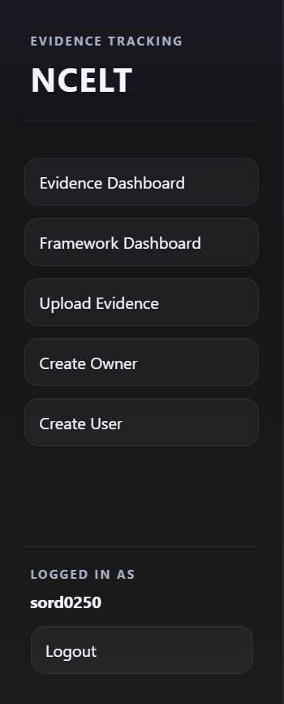
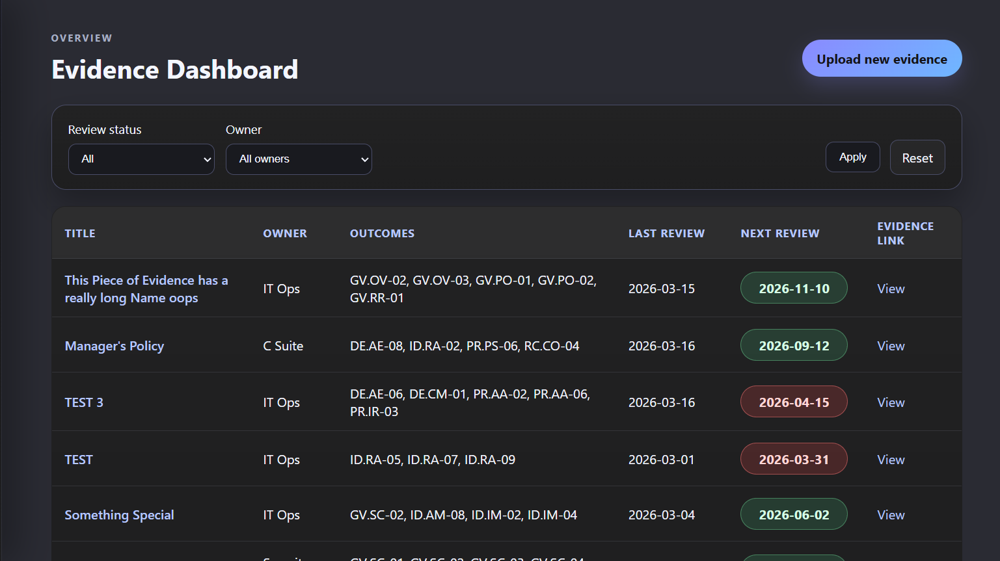
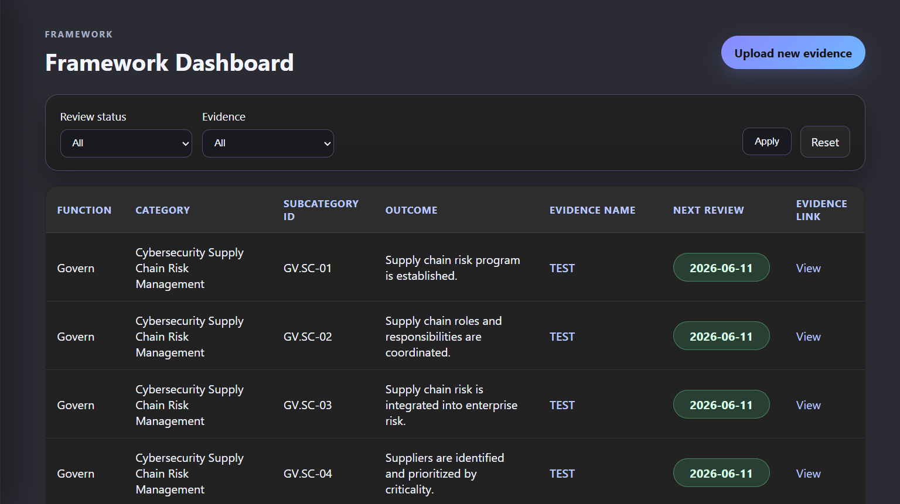
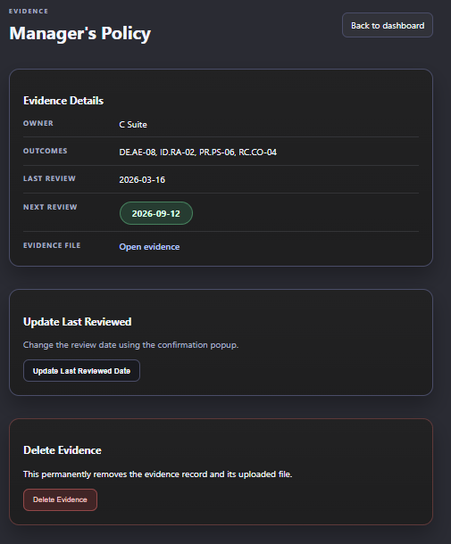
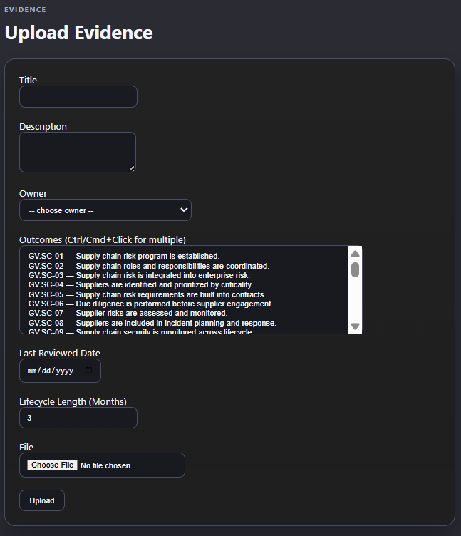
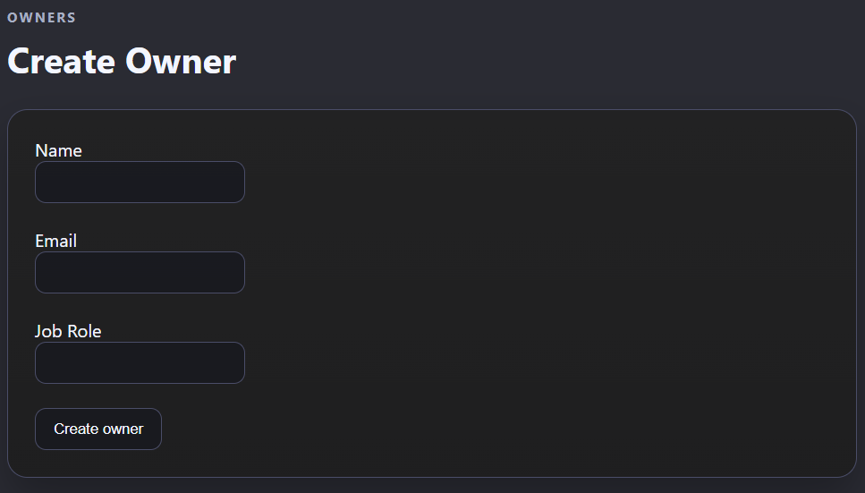
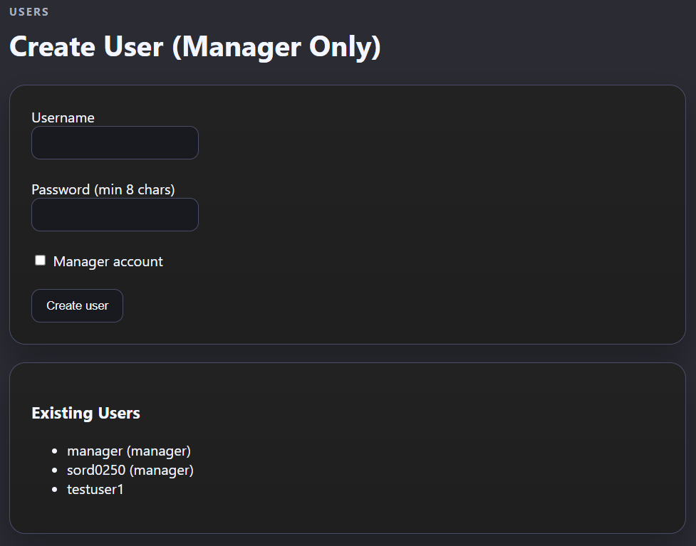

# The NCELT App

This file maps the active application files currently present in the repo and skips generated databases, uploaded evidence, and editor settings.

NCELT is a local evidence-tracking web app that lets a team upload supporting files, assign them to owners and framework outcomes, and monitor review dates from the evidence and framework dashboards. For a first local run, create or activate a Python environment, install dependencies with `pip install -r requirements.txt`, start the server with `python -m uvicorn app.main:app --reload`, open `http://127.0.0.1:8000`, and use the `/setup` page to create the first manager account; if you also want starter owners and framework outcomes loaded, run `python -m app.seed` once before or after that initial setup.

## Table of Contents

- [.gitignore](#gitignore)
- [requirements.txt](#requirementstxt)
- [update_paths.py](#update-pathspy)
- [documentation/RelationalSchema.png](#documentationrelationalschemapng)
- [app/main.py](#appmainpy)
- [app/db.py](#appdbpy)
- [app/models.py](#appmodelspy)
- [app/crud.py](#appcrudpy)
- [app/seed.py](#appseedpy)
- [app/scheduler.py](#appschedulerpy)
- [app/static/styles.css](#appstaticstylescss)
- [app/templates/base.html](#apptemplatesbasehtml)
- [app/templates/dashboard.html](#apptemplatesdashboardhtml)
- [app/templates/framework.html](#apptemplatesframeworkhtml)
- [app/templates/evidence_detail.html](#apptemplatesevidence_detailhtml)
- [app/templates/upload.html](#apptemplatesuploadhtml)
- [app/templates/create_owner.html](#apptemplatescreate_ownerhtml)
- [app/templates/create_user.html](#apptemplatescreate_userhtml)
- [app/templates/login.html](#apptemplatesloginhtml)
- [app/templates/setup.html](#apptemplatessetuphtml)

## .gitignore

Defines which local files and folders Git should ignore so sensitive variable stay out of Github.

## requirements.txt

Lists the Python packages the project depends on to run the web app and its supporting scripts.

## update_paths.py

Runs a small SQLite update that trims stored evidence file paths down to just the filename.

## documentation/RelationalSchema.png

Stores a visual reference of the database relationships used by the app.

## app/main.py

Acts as the FastAPI entry point and defines the app setup, authentication flow, uploads, dashboards, and evidence routes.

## app/db.py

Configures the SQLAlchemy engine, session factory, base model class, and SQLite connection settings.

## app/models.py

Declares the SQLAlchemy tables and relationships for users, owners, outcomes, evidence, and their join table. These are created based on the relational schema mentioned above. 

The tables include:
- Users: keeps track of a user's information
- Owner: the people or groups that will own the different evidences
- Outcome: a specific outcome in the NIST framework, identified by the subcategory ID
- Evidence: the file that a user uploads which gets mapped to (an) outcome(s)

## app/crud.py

Provides the database helper functions used to create, read, update, delete, and authenticate app records.

## app/seed.py

Creates the initial database content, including a default manager account, starter owners, and framework outcomes.

## app/scheduler.py

Exists as a placeholder for scheduled or background job logic but is currently empty. This was out of scope at the time.

## app/static/styles.css

Contains the shared styling for the layout, navigation, forms, tables, badges, and modal components.

## app/templates/base.html

Provides the shared page shell and sidebar navigation that the other templates extend.

## app/templates/dashboard.html

Renders the main evidence dashboard with filters and a table of uploaded evidence records. Users can filter by 'Review Status' and 'Owner'.

## app/templates/framework.html

Renders the framework dashboard that shows each outcome alongside its latest linked evidence and review timing. Filters by 'Review Status' and 'Evidence Existence' are available.

## app/templates/evidence_detail.html

Shows a single evidence record in detail and includes actions to update its review date or delete it.

## app/templates/upload.html

Displays the form for uploading a file and assigning its owner, outcomes, and review lifecycle.

## app/templates/create_owner.html

Displays the form used to add a new owner record for evidence assignments. A note here: the organization must decide whether owners will be teams or specific people. This will be crucial when presenting the evidence to auditors.

## app/templates/create_user.html

Displays the manager-only form for creating users and the list of existing accounts.

## app/templates/login.html

Displays the login form for signing into the app.

## app/templates/setup.html

Displays the first-run setup form for creating the initial manager account.
